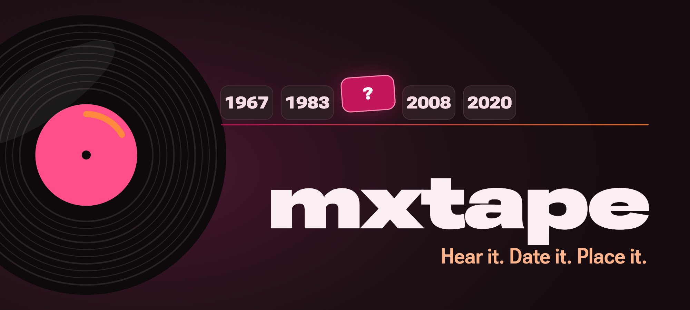
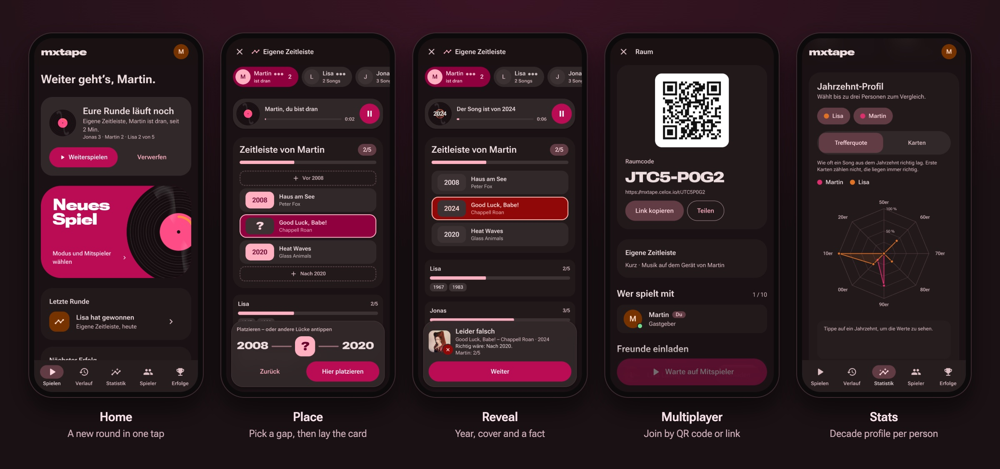

<div align="center">

<a href="https://mxtape.celox.io"></a>

# 📼 mxtape

**English** · [Deutsch](README.de.md)

**The music timeline game for your group: hear a song, guess its year, slot it into the right place on your timeline — on one phone passed around, or everyone on their own device, in one room or across town.**

<p>
  <a href="https://mxtape.celox.io"></a>
</p>

<h3>👉 <a href="https://mxtape.celox.io">mxtape.celox.io</a> — sign in with Google or email, or join a friend's room as a guest with just a link</h3>

<!-- BADGES:BIG — version, tests, lines of code and songs; readme.test.ts keeps them true, scripts/readme-badges.mjs rewrites them. -->
[](https://github.com/pepperonas/mxtape/releases/latest)
[](#tests-and-ci)
[](pwa/src)
[](#tests-and-ci)
[](#the-song-library)

[](https://www.paypal.com/donate/?business=martin.pfeffer@celox.io&currency_code=EUR&item_name=mxtape)

</div>

<!-- Project status — the GitHub badges are live and update themselves. -->

[](https://github.com/pepperonas/mxtape/actions/workflows/ci.yml)
[](https://github.com/pepperonas/mxtape/releases/latest)
[](https://github.com/pepperonas/mxtape/releases/latest)
[](https://github.com/pepperonas/mxtape/commits/main)
[](https://github.com/pepperonas/mxtape/commits/main)
[](#project-structure)
[](https://www.typescriptlang.org)
[](https://github.com/pepperonas/mxtape/issues)
[](https://github.com/pepperonas/mxtape/stargazers)
[](LICENSE)
[](https://celox.io)

<!-- Frontend -->

[](https://react.dev)
[](https://www.typescriptlang.org)
[](https://vite.dev)
[](https://tailwindcss.com)
[](https://motion.dev)
[](https://reactrouter.com)
[](https://howlerjs.com)
[](#install)
[](#design)
[](#features)
[](#design)

<!-- Backend & realtime -->

[](https://fastapi.tiangolo.com)
[](https://www.python.org)
[](https://www.sqlalchemy.org)
[](https://sqlite.org)
[](#multiplayer)
[](#access)
[](#how-it-works)

<!-- Engineering practice -->

[](https://vitest.dev)
[](https://testing-library.com)
[](https://pytest.org)
[](https://www.conventionalcommits.org)
[](https://semver.org)
[](CONTRIBUTING.md)

<!-- What makes it fun -->

[](#game-modes)
[](#game-modes)
[](#multiplayer)
[](#multiplayer)
[](#game-modes)
[](#features)
[](#game-modes)

<!-- What mxtape deliberately does not do -->

[](#the-song-library)
[](#design-philosophy)
[](#design-philosophy)
[](#design-philosophy)

> **Name that year.**

mxtape is a private music game for groups. A record spins, a song plays, and whoever is on turn slots the song into their timeline — before 1983? between 1983 and 2008? The year is only revealed once the card is down. Get it right and the card stays; get it wrong and someone else may claim it with an objection.

It runs as an installable web app with a **Material 3 Expressive** interface built around one signature element: a vinyl record that spins while the song plays and shows the year on its label after the reveal.

---

## Table of Contents

- [Screenshots](#screenshots)
- [Access](#access)
- [Game modes](#game-modes)
- [Multiplayer](#multiplayer)
- [Features](#features)
- [The song library](#the-song-library)
- [Design](#design)
- [Install](#install)
- [Development](#development)
- [Tech stack](#tech-stack)
- [Project structure](#project-structure)
- [Tests and CI](#tests-and-ci)
- [How it works](#how-it-works)
- [Deployment](#deployment)
- [Design philosophy](#design-philosophy)
- [Troubleshooting](#troubleshooting)
- [Roadmap](#roadmap)
- [Developer](#developer)
- [Donate](#donate)
- [License](#license)

---

## Screenshots



<sub>The app's interface is German. Single screens live in <a href="docs/screenshots">docs/screenshots</a>.</sub>

---

## Access

mxtape is a private app. You sign in with a Google account or with email and password (the address is confirmed by a link first); new accounts land on a waiting list and are approved one by one. Guests who played an online round are offered an account of their own at the end. Only then are the game and the music reachable — the server hands the audio files only to approved sessions.

The one exception: **guests in a room.** Whoever opens a room link types a name and plays along, no account needed, for as long as the room is open.

## Game modes

| Mode | Goal |
|------|------|
| **Own timeline** | Everyone builds their own timeline. The first to have the target number of songs placed correctly wins. |
| **Shared timeline** | Everyone places on the same timeline. Once the target is reached, whoever placed the most cards wins. |
| **Hardcore** | Guess title (+5), artist (+5) and year (+5 exact, +2 one year off, +1 two off). When everyone has played the target number of songs, the highest score wins. |

Before each round you choose:

- **Length:** short (5 songs), normal (10) or long (15).
- **Decades:** all, or only some — just the 80s and 90s, say. When the chosen decades run dry, the rest join in so the round never stalls.
- **Genre and selection:** pop, rock, soul & R&B, hip-hop, electronic, other — and a selection: all songs, *party classics*, *German songs*, or *your nemeses* (the songs your group got wrong before, from ten misses on).
- **Bonus for title and artist** (timeline modes): the card stays face down — you only listen. Name title and artist when placing and earn a joker (at most three); a joker swaps a song you would rather not place.
- **Objection** (timeline modes): everyone has three. After a card is placed it stays face down, and anyone who disagrees moves it to another gap. If the player was wrong and the objection right, the objector gets the card. An objection always costs one of the three.
- **Exotics:** off by default. Turned on, little-known club tracks, remixes and rarities join the pool.
- **Teams** (from four people): a team shares its timeline, points and objections; members take turns.

Songs from your recent rounds only come back once nothing new is left; songs start where they become recognisable (silent and quiet intros are skipped). **There are no draws:** if several players are level at the end, a tiebreak follows — only they play on, one song each per round, until exactly one leads. Playing alone? Up to three bots (easy, medium, hard) take you on.

## Multiplayer

Instead of passing one phone around, everyone plays on their own device — in the same room or each at home.

- **Open a room:** choose "Jeder sein Gerät" in the setup. You get a link, a QR code and a room code to type in.
- **No account needed:** guests type a name and play. Nothing is stored for them; they hear the music only while the room is open.
- **No waiting forever:** online every step has a time limit (draw 30 s, place until 30 s after the song ended, move on 20 s); after that the game acts for the player, never the host by choice.
- **Objections online:** after a card is placed, everyone who may object taps *Object* or *No objection*; otherwise the card turns over by itself after 10 seconds. Nobody can reveal early for the others.
- **Music:** *together in the room* — only the device of whoever's turn it is plays (the host takes over if that device drops out), no echo. *Everyone at home* — all devices play in sync (measured ~20 ms apart).
- **Playing:** whoever is on turn places or guesses on their own device; everyone else watches live and objects from their own phone. A reload or a short drop-out costs nothing — everyone gets their seat back.
- **TV mode:** open the room link on a TV or laptop and choose *Use as a screen* — it shows the round big for everyone, plays the music and stays awake; people play on their phones. A screen joins in the lobby, like everyone else.
- **Bots and teams online:** the host fills the round up with up to three bots (played on the host's device) or shuffles the people into teams; team members take turns, each on their own phone.
- **The host's phone dies?** After 30 seconds any account in the room may take over; the round carries on from their device.
- **Friends:** search other accounts by name or e-mail, add them as friends and invite them straight from the room; the invitation appears on their home screen.
- At the end, the round lands in the history of every player with an account.

## Features

- **500 songs** from the 1950s to today, self-hosted, with an optional random start position
- **Daily round:** the same ten songs for everyone each day, one try, then your friends' scores
- **Share the result** as a picture (WhatsApp and the like) from the end screen
- **Report a song** after the reveal (wrong year, version, sound or cover); the admin fixes the year or takes the song out, live for every round
- **Reveal with context:** album cover on the record label, album name and a short "Did you know?"
- **Where the card goes is obvious:** neighbour years light up and a position strip reads `2008 — ? — 2020` in the poster type
- **A running round survives a reload** or a closed tab and is offered on the home screen
- **Forgiving answers** in hardcore mode (typos, case)
- **24 achievements**, a history of every round with ranking and all songs
- **Statistics:** rounds, songs, hit rate and playing time; a decade profile as a spider web comparing up to three people; wins, rounds per week, modes, the hardest and the safest songs
- **Players:** everyone with rounds, wins and hit rate; rename, merge, remove; a page per person
- History, achievements and settings belong to the account and look the same on every device
- Installable PWA, light and dark theme
- **German and English**, detected from the browser and switchable on the login screen and in the profile; song facts in both languages
- **Imprint, privacy policy and terms** in the app, readable without an account; delete your account with one tap in the profile

## The song library

500 songs, 39 of them marked as exotics. The source of truth is [`docs/songs.json`](docs/songs.json); facts live in [`docs/song-facts.json`](docs/song-facts.json). Release years and albums come from **MusicBrainz**, covers from the **Cover Art Archive** (iTunes as fallback). Spotify is not used anywhere.

```bash
node scripts/song-management/add-song.js "a-ha" "Take on Me"   # suggests year and album, fetches audio and cover
./scripts/deployment/deploy.sh web
```

Audio is AAC-LC at 96 kbit/s, cut at four minutes with a short fade. Details, swapping and editing: [`scripts/audio-hosting/README.md`](scripts/audio-hosting/README.md).

## Design

Material 3 Expressive with its own identity: **vinyl magenta** as primary colour, warm amber as accent. The record is the one signature element — it spins while the song plays and shows the year on its label after the reveal; everything around it stays quiet. In the background fine sound waves drift along the bottom of the screen and swell while a song plays.

- Palettes are **generated** from seeds (`pwa/scripts/gen-tokens.mjs` → `pwa/src/styles/design-tokens.css`); no raw colours anywhere else
- Real springs (stiffness + damping) as one source for JS (`motion`) and CSS (`linear()` curves)
- Page changes via the View Transitions API, theme changes as a circular reveal
- Online: a lost connection shows at once and that player is skipped after 30 s until they are back; whoever leaves is out of the round
- Drag the card onto the timeline, and drag it again to another gap until you confirm
- Subtle vibration on phones when you grab, drop and turn a card over (can be switched off)
- `prefers-reduced-motion` respected everywhere, touch targets at least 48 px
- Roboto Flex self-hosted, every symbol an inline SVG — no emoji in the UI

## Install

mxtape is a web app — open [mxtape.celox.io](https://mxtape.celox.io) and use *Add to home screen* (Android/Chrome) or *Share → Add to Home Screen* (iOS/Safari). It then starts full screen like an app.

## Development

```bash
# Backend (port 4274)
cd server && python3 -m venv .venv && .venv/bin/pip install -r requirements-dev.txt
cp .env.example .env            # MX_DEV_LOGIN=true for local sign-in without Google
.venv/bin/uvicorn app.main:app --port 4274 --reload

# Frontend (port 5174, proxies /api to the backend)
cd pwa && npm install && npm run dev
# sign in locally: http://127.0.0.1:5174/api/auth/dev-login?email=…&name=…
```

Use `127.0.0.1` consistently — the session cookie is bound to the host.

## Tech stack

| Layer | Choice |
|-------|--------|
| UI | React 19, TypeScript, Tailwind CSS 3.4, Motion (LazyMotion, `m.*` only), React Router 7 data router |
| Audio | Howler.js, HTML5 audio, same-origin `/audio/` behind the login |
| PWA | vite-plugin-pwa (Workbox), versioned cache, network-first navigations |
| API | FastAPI, SQLAlchemy 2, SQLite in WAL mode, uvicorn (one worker — the room hub lives in memory) |
| Realtime | WebSocket per room seat, server-stamped seats, clock offset from ping medians |
| Auth | Google OAuth code flow with PKCE, or email + password (scrypt, confirmation link, reset link); httpOnly session cookie, CSRF header |
| Hosting | nginx on a VPS, `auth_request` gate for audio, systemd service |

## Project structure

```
pwa/      React 19 PWA (Vite, Tailwind, motion)
  src/game/     pure game rules: placement, guesses, objection, tiebreak, song pool, stats
  src/online/   rooms: protocol, client, host bridge, permission rules, sanitizing
  src/screens/  one file per screen
server/   FastAPI + SQLite: Google and email sign-in, waiting list, admin, account data, audio gate, rooms (WebSocket), friends
docs/     songs.json — the song database (source of truth), facts, screenshots
scripts/  song management, audio hosting, deployment
```

## Tests and CI

| Suite | What it covers |
|-------|----------------|
| `cd pwa && npx vitest run` | game rules, turn flow, objection, tiebreak, stats, sync and merge, online permissions and sanitizing, screens |
| `cd server && .venv/bin/python -m pytest -q` | sign-in and approval, data versioning, audio gate, rooms and WebSocket relay, friends and search, song reports, daily round |
| `npm test` (repo root) | integrity of the song data |
| `cd pwa && npm run e2e` | two browsers play an online round against the real API (join, place, pass, object) |
| `cd pwa && npx tsc --noEmit` | types |

GitHub Actions runs all of it on every push ([`ci.yml`](.github/workflows/ci.yml)). The big numbers at the top are kept honest by `pwa/src/__tests__/readme.test.ts`; `node scripts/readme-badges.mjs` recounts and rewrites them.

## How it works

- **The host computes, the server relays.** In a room, the game runs on the host's device with exactly the same rules as on one device. The server keeps rooms, seats and the latest snapshot, and passes messages on — no game rule exists twice.
- **Nobody can peek.** Before the reveal, the snapshot sent to other devices carries the song without year, album and fact.
- **Music only for those who may hear it.** nginx asks the API (`auth_request`) before serving any audio file: approved sessions and guests of an open room get through, everyone else gets a 401.
- **Account data** (history, achievements, settings) is stored per account with optimistic versioning; conflicting edits from two devices are merged, not overwritten.

## Deployment

```bash
./scripts/deployment/deploy.sh        # API and web app (runs the tests first)
./scripts/deployment/deploy.sh api    # backend only
./scripts/deployment/deploy.sh web    # PWA only
```

Once on the server: secrets in `/opt/mxtape-api/.env` (template `server/.env.example`) and the nginx locations from `server/deploy/nginx-locations.conf`. The Google OAuth client (web application) needs the redirect URI `https://mxtape.celox.io/api/auth/callback`; publish the consent screen, or Google only lets listed test users through.

## Design philosophy

- **One game, many screens.** The rules are pure functions; one device, the host of a room and every guest use the same code.
- **Private by default.** Sign-in only, approval by hand, audio behind the login, no ads, no third-party trackers (page views are counted cookieless by a self-hosted Umami).
- **Virtual only.** No printed cards, no Spotify — just a phone, a song and a timeline.

## Troubleshooting

**"Access blocked" at Google sign-in** — the consent screen is still in testing mode; only listed test users get through.

**No sound after a reload** — phones block autoplay until the first tap. Tap the record or the play button.

**A scanned room link opens the home screen** — an app version from before v0.7.2 is cached on that phone. Open mxtape once and reload; room links always load fresh since then.

**Old bookmarks** — addresses were German until v0.8.1 (`/verlauf`, `/raum/…`) and the domain was mxster.celox.io until v0.8.0. Both still work and redirect.

## Roadmap

- Achievements for every account in an online round (today only the host's)
- More songs, especially from the 50s and the 2020s

Ideas and bug reports are welcome as [issues](https://github.com/pepperonas/mxtape/issues).

---

## Developer

**Martin Pfeffer** · [celox.io](https://celox.io)

GitHub: [@pepperonas](https://github.com/pepperonas) · Email: [martin.pfeffer@celox.io](mailto:martin.pfeffer@celox.io)

mxtape was called **mxster** until October 2026; mxster.celox.io redirects here.

---

## Donate

If mxtape made your last game night louder, consider buying me a coffee (or a new record) via **PayPal**:

[](https://www.paypal.com/donate/?business=martin.pfeffer@celox.io&currency_code=EUR&item_name=mxtape)

Donations are never expected — the app stays free and ad-free.

---

## License

MIT — see [LICENSE](LICENSE).

### Third-party components

| Component | License |
|-----------|---------|
| [Roboto Flex](https://github.com/googlefonts/roboto-flex) — self-hosted in `pwa/public/fonts/` | SIL Open Font License 1.1 |
| React, React Router, Vite, Tailwind CSS, Motion, Howler.js, qrcode-generator | MIT |
| FastAPI, SQLAlchemy, uvicorn | MIT / BSD |
| Song metadata from [MusicBrainz](https://musicbrainz.org), covers from the [Cover Art Archive](https://coverartarchive.org) | CC0 / per image |

The music itself is not part of this repository and not covered by its license; the audio files live on the server and are only served to approved accounts for private use.
